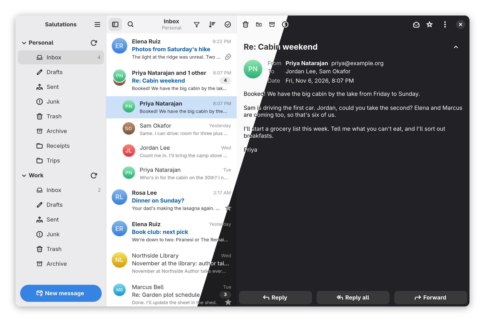
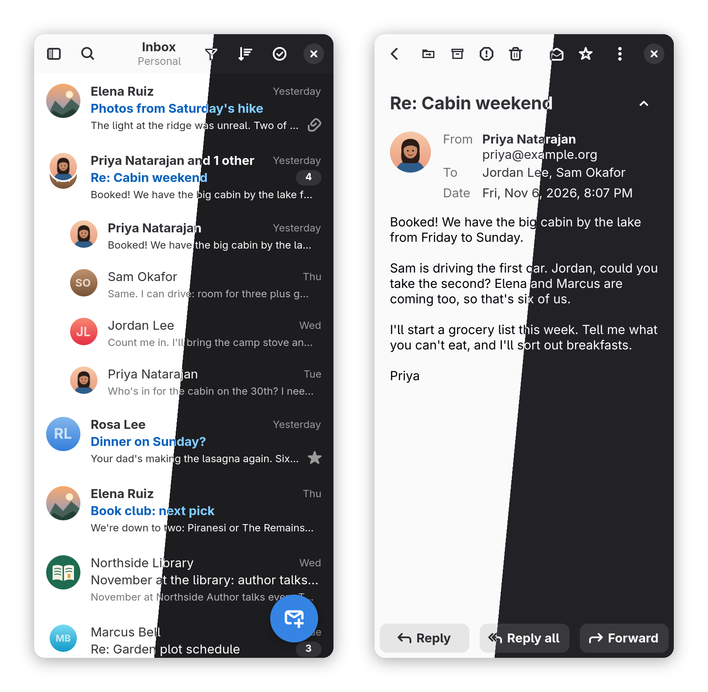

# Salutations

**Lean mail for GNOME Online Accounts**

Salutations reads and sends mail from the accounts you have already added
in GNOME Online Accounts. There is nothing else to set up: switch Mail on
for an account in Settings and it shows up, folders and all.

## Made for phones as much as desktops

- An adaptive layout: three panes on a wide screen, the message beside or
  below the list, and one pane at a time on a phone.
- Touch throughout: pull to refresh, long press to select, and tap a
  name for its contact menu.
- Hover actions, drag to folders and keyboard shortcuts on the desktop.

## Private and secure

- **Remote content stays blocked** until you allow it for a message, a
  sender or a whole domain. When it loads, Salutations fetches it
  itself, without cookies, so senders learn as little as possible.
- **Basic tracking can be removed** from remote content: known tracking
  codes and your own address are stripped before anything is fetched.
- **Links are checked before they open.** A link whose text names a
  different site is flagged, and tracking parameters and redirect
  wrappers can be removed.
- **Forged senders are flagged** when your provider's checks (DMARC)
  show a message did not come from the domain it claims. Verified
  senders can show their brand logo (BIMI).
- **OpenPGP signing and encryption** use your own GnuPG keys. Missing
  keys for recipients can be looked up, and keys that trusted senders
  include are offered for import.

## Reading and organizing

- Threaded or flat lists, newest or oldest first, with filters for
  unread, starred and messages with attachments.
- Star, mark read, move, archive, Junk and Trash, all with undo. The list
  responds at once, so clearing out a full inbox never waits on the
  server.
- Selection mode for working through many messages, with quick
  selection of all read, unread, starred or unstarred messages.
- Search a folder, an account or every account, including message
  bodies on the server.
- Full or compact message headers, folded quotes, printing and saving
  messages as files.
- Avatars from your address book, OpenPGP photo IDs and the `Face:` and
  `X-Face:` headers; Libravatar and Gravatar if you turn them on.

## Writing

- Plain text, or Markdown sent as formatted mail.
- Recipient completion from your address books, attachments by drag and
  drop, and spell checking.
- Drafts are saved to the server as you write, and mail written offline
  waits and goes out once you are back online.

## Always there

- Keeps running with the window closed, and can start at login.
- Notifications for new mail with the sender's avatar, sound switchable
  per account, and an unread count on the dock icon.
- Works with self-signed servers you have accepted in GNOME Online
  Accounts, such as Proton Mail Bridge.

## Installing

### Flatpak (recommended)

| <a href="https://ajdunevent.github.io/AJHub/"><picture><source media="(prefers-color-scheme: dark)" srcset="https://ajdunevent.github.io/AJHub/badges/button-dark.svg"></picture></a> | <a href="https://furihub.github.io/repo/"><picture><source media="(prefers-color-scheme: dark)" srcset="https://furihub.github.io/repo/badges/button-dark.svg"></picture></a> |
| --- | --- |
| x86_64 & aarch64 | aarch64 only |

## Feedback and support

Bugs and ideas are welcome in the
[issue tracker](https://dev.dunevent.net/aj/Salutations/issues).
If you would like to support the work,
[donations](https://dunevent.net/donate) are appreciated.
Building from source and the technical details are in
[DEVELOPMENT.md](DEVELOPMENT.md).

## License

Salutations is free software under the GNU General Public License,
version 3 or later. Some parts carry their own licenses; see
[DEVELOPMENT.md](DEVELOPMENT.md#licensing).
